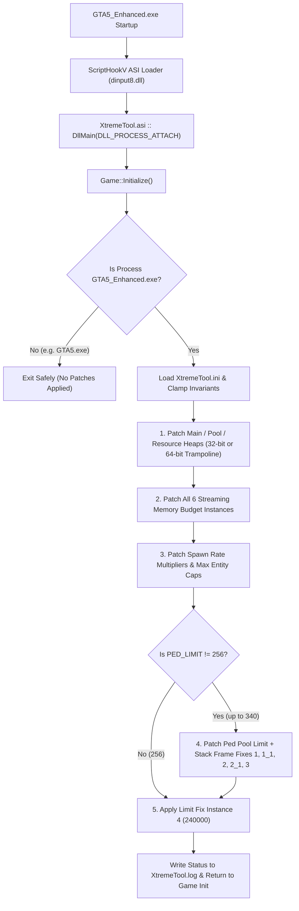

<div align="center">

# ⚡ XtremeTool Enhanced (`v1.2` C++20 Recreation)

**High-Performance Memory Allocator, Pool Expander & Traffic/Ped Density Engine for *Grand Theft Auto V Enhanced Edition* (`GTA5_Enhanced.exe`)**

[](#)
[](#)
[](#)
[](#)

*Originally developed by **XtremeV (-Vegas-)** • Recreated & documented in modern C++20*

</div>

---

> [!IMPORTANT]
> ### 🤖 AI Disclaimer
> This repository and its documentation were **reverse-engineered, recreated, and documented with the assistance of an AI coding agent (Antigravity)** based on the official [XtremeTool Enhanced v1.2](https://www.gta5-mods.com/misc/xtremetool-enhanced) binary release and the original open-source [XtremeV/Xtreme-Tool](https://github.com/XtremeV/Xtreme-Tool) project.
>
> While all 16 memory signatures, offsets, and instruction patches have been verified byte-for-byte against `XtremeTool.asi` v1.2, this project is an **unofficial community recreation** provided *"as-is"* without warranty. Always back up your game files before installing native memory mods, and never use ASI plugins in *GTA Online*.

---

## 📖 Table of Contents

- [✨ Overview](#-overview)
- [🔧 Patches & Fixes: Legacy GTA V vs. Current GTA V Enhanced](#-patches--fixes-legacy-gta-v-vs-current-gta-v-enhanced)
- [🛡️ Additional Stability Fixes in This C++20 Recreation](#️-additional-stability-fixes-in-this-c20-recreation)
- [⚙️ How It Works Under the Hood](#️-how-it-works-under-the-hood)
- [🧩 Engine Patch Matrix](#-engine-patch-matrix)
- [📝 Configuration Reference (`XtremeTool.ini`)](#-configuration-reference-xtremetoolini)
- [🚀 Installation](#-installation)
- [🛠️ Building from Source](#️-building-from-source)
- [📂 Project Structure](#-project-structure)
- [🔍 Troubleshooting (`XtremeTool.log`)](#-troubleshooting-xtremetoollog)

---

## ✨ Overview

**XtremeTool Enhanced** is a native x64 `.asi` plugin for **Grand Theft Auto V Enhanced Edition** (`GTA5_Enhanced.exe`) that patches the engine in memory at process startup (`DLL_PROCESS_ATTACH`)—before the game initializes its memory allocators, streaming budgets, and entity pools:

- 🧠 **Breaks the 2 GB / 4 GB Heap Barrier**: Expands the **Main Heap**, **Pool Heap**, and **Resource Heap** using either 32-bit immediate patches or 64-bit executable trampolines (`movabs rdx/r9/r8, imm64`).
- 📦 **Streaming Memory Budget Unlocker**: Increases `PED_MEM_SIZE` and `VEH_MEM_SIZE` budgets across all 6 engine streaming instances to prevent texture/model pop-in with high-poly modded peds and vehicles.
- 🚗 **Traffic & Pedestrian Spawn Multipliers**: Multiplies ambient walking ped, scenario ped, ambient traffic vehicle, and parked vehicle spawn rates.
- 👥 **Ped Pool Limit Overrider (`PED_LIMIT` up to `340`)**: Raises the `CPed` pool limit and maximum active ped/vehicle caps without requiring `gameconfig.xml` edits for peds, while dynamically expanding main-thread stack frames to prevent stack-overflow crashes.
- ⏱️ **Benchmark Pathfinding Skip**: Optionally bypasses the ped pathfinding pass (`SKIP_PEDS_PATHFIND_PASS`) to benchmark CPU/FPS scaling under heavy entity loads.

---

## 🔧 Patches & Fixes: Legacy GTA V vs. Current GTA V Enhanced

The original open-source **Xtreme-Tool** targeted Legacy `GTA5.exe`. To make it work with current **GTA V Enhanced Edition (`GTA5_Enhanced.exe`)**, the following architectural changes, signature updates, and engine fixes were introduced:

### 1. Executable Guard Updated for `GTA5_Enhanced.exe`
- **Legacy (`GTA5.exe`)**: Checked `GetModuleBaseNameA` against `"GTA5.exe"`.
- **Enhanced (`GTA5_Enhanced.exe`)**: [`Game::IsEnhancedEdition()`](src/Game.cpp) explicitly verifies the host process is `"GTA5_Enhanced.exe"`, preventing accidental cross-version memory corruption if dropped into a Legacy installation.

### 2. Re-Engineered x64 Signatures for the Gen9 / Enhanced Codebase
`GTA5_Enhanced.exe` was compiled with a newer MSVC toolchain and different register allocations, invalidating the Legacy byte patterns. All **16 byte signatures and target offsets** in [`src/Game.cpp`](src/Game.cpp) were updated for the Enhanced Edition binary:
- **Main Heap Allocator**: Updated to `BA ?? ?? ?? ?? 45 31 C0 41 B1 01 E8 ?? ?? ?? ?? 48 8D 0D` (patching `mov edx, imm32` at `+0x01`).
- **Pool Heap Allocator**: Updated to `48 ?? ?? ?? ?? ?? ?? 48 ?? ?? ?? ?? ?? ?? 41 B8 00 00 01 00 41 B9 ?? ?? ?? ?? E8` (patching `mov r9d, imm32` at `+0x16`).
- **Resource Heap Allocator**: Newly added in Enhanced (`48 ?? ?? ?? ?? ?? ?? BA 00 20 00 00 41 B8 ?? ?? ?? ??`, patching `mov r8d, imm32` at `+0x0E`) to control the Gen9 resource heap (`RESOURCE_SIZE`, default `3500 MB` vanilla / `4000 MB` modded).
- **Streaming Memory Budget**: Scans all 6 occurrences of `add eax, 0x16E360` (`05 60 E3 16 00`, default `1.5 MB`) and replaces the 32-bit immediate with `PED_MEM_SIZE << 20`.
- **Config Getter Hooks (Spawn Multipliers & Max Entity Caps)**: In `GTA5_Enhanced.exe`, spawn multipliers and active entity caps are read via structure offset getters (`48 8D 51 <off1> 48 83 C1 <off2> E8 <rel32>`, 13 bytes total). Each getter is replaced inline with `movabs rax, <val>; nop; nop; nop` (`48 B8 <imm64> 90 90 90`).

### 3. 64-Bit Heap Trampolines (`> 2 GB / 4 GB` Support)
In `GTA5_Enhanced.exe`, the allocator size parameters (`edx`, `r9d`, `r8d`) are loaded using 32-bit `mov` instructions (5 or 6 bytes), and the Main Heap size is treated as a **signed 32-bit integer** (capping out at `2 GB`). Because a 10-byte 64-bit `movabs reg, imm64` instruction does not fit inline:
- [`Game::PatchMainHeapSize64`](src/Game.cpp), [`Game::PatchPoolHeapSize64`](src/Game.cpp), and [`Game::PatchResourceHeapSize64`](src/Game.cpp) allocate a `0x1000`-byte `PAGE_EXECUTE_READWRITE` trampoline, store the trampoline pointer at `[hookSite - 0xFFF]`, and patch the 6-byte instruction at `hookSite` with a RIP-relative indirect jump (`FF 25 FB EF FF FF` -> `jmp qword ptr [rip - 0x1005]`).
- The trampoline loads the full 64-bit byte count (`movabs rdx/r9/r8, imm64`), restores clobbered instructions, and jumps back to the instruction following the hook.

### 4. Main-Thread Stack Frame Expansion for `PED_LIMIT > 256`
Raising `PED_LIMIT` above `256` in `GTA5_Enhanced.exe` previously caused instant crashes because two core ped-processing functions allocate fixed-size scratch arrays on the **main thread's stack** sized specifically for `256` peds:
- **[`Game::PatchLimitFixInstance1`](src/Game.cpp)**: Locates the function prologue `mov eax, 0x1048; call __chkstk` (`0x1048 = 256 * 16 + 0x48`) and matching epilogue `add rsp, 0x1048`, and adds `(PED_LIMIT - 256) * 16` to both stack frame immediates.
- **[`Game::PatchLimitFixInstance2`](src/Game.cpp)**: Locates the function prologue `sub rsp, 0xC28` (`0xC28 = 256 * 12 + 0x28`), two pairs of internal stack-buffer offsets (`0x820 = 256 * 8 + 0x20` and `0x420 = 256 * 4 + 0x20`), and the matching epilogue `add rsp, 0xC28`. It dynamically adds `(PED_LIMIT - 256) * 12` to `sub rsp`, `add rsp`, and `0x820`, and adds `(PED_LIMIT - 256) * 8` to `0x420`.
- **`PED_LIMIT <= 340` Safety Clamp**: Because the Windows PE header of `GTA5_Enhanced.exe` specifies a fixed main-thread stack reserve size, [`Game::Initialize`](src/Game.cpp) clamps `PED_LIMIT` to a maximum of `340` and logs a warning if exceeded.
- **Pool Size vs. Heap Size Guard**: Automatically clamps `POOL_SIZE` to `HEAP_SIZE / 2` if the user configures `POOL_SIZE >= HEAP_SIZE`.

### 5. Pure Native x64 Build (Removed Accidental `/clr` Dependency)
The original Legacy `Xtreme-Tool.vcxproj` had `<CLRSupport>true</CLRSupport>` enabled in its Release configuration, unnecessarily pulling in `.NET Framework` MSIL metadata and `mscoree.dll`. Both XtremeTool Enhanced v1.2 and this project compile as **100% pure native x64 C++** with zero `.NET` runtime dependencies.

---

## 🛡️ Additional Stability Fixes in This C++20 Recreation

While reverse-engineering the `XtremeTool.asi` v1.2 binary, we identified and fixed two low-level memory-safety bugs present in the compiled v1.2 binary:

1. **Page-Boundary `VirtualProtect` Size Fix (`ACCESS_VIOLATION` Prevention)**
   - **In the original v1.2 binary**: The 13-byte spawn/cap patcher (`48 B8 <8-byte imm64> 90 90 90`) only passed `dwSize = 10` (`0x0A`) to `VirtualProtect`, and the 8-byte `Limit Fix 4` patcher (`B8 <4-byte imm32> 90 90 90`) only passed `dwSize = 5` (`0x05`). If a matched instruction ever straddled a 4 KB memory page boundary such that the trailing `NOP` bytes (`90 90 90`) fell on the next page, writing them would trigger an unhandled `STATUS_ACCESS_VIOLATION` (`0xC0000005`).
   - **In this recreation**: [`Memory::WriteMovRaxImm64Nop3`](src/Pattern.cpp) and [`Game::PatchLimitFixInstance4`](src/Game.cpp) pass the full `sizeof(patch)` (`13` bytes and `8` bytes respectively) to `VirtualProtect`.
2. **Null-Pointer & Bounds Guard in `PatchLimitFixInstance2`**
   - **In the original v1.2 binary**: If either inner scan for the `0x820` (`20 08 00 00`) or `0x420` (`20 04 00 00`) stack offsets reached the end of the module without a match, the registers `rsi` / `r14` were zeroed (`xor esi, esi; xor r14d, r14d`) and immediately dereferenced (`mov edi, dword ptr [r14]`), causing a null-pointer crash.
   - **In this recreation**: [`Game::PatchLimitFixInstance2`](src/Game.cpp) validates `if (pos420 && pos820)` before modifying memory, and [`Memory::FindPatternRange`](src/Pattern.cpp) checks `startAddr + maskLen <= endAddr` to prevent reading past the end of the module image.

---

## ⚙️ How It Works Under the Hood



---

## 🧩 Engine Patch Matrix

| # | Patch Routine (`src/Game.cpp`) | INI Setting(s) | Target Pattern & Action |
| :-: | :--- | :--- | :--- |
| **1** | [`PatchMainHeapSize32`](src/Game.cpp)<br>[`PatchMainHeapSize64`](src/Game.cpp) | `HEAP_SIZE`<br>`USE_64BIT_HEAP_SIZE` | `BA ?? ?? ?? ?? 45 31 C0 41 B1 01 E8 ?? ?? ?? ?? 48 8D 0D`<br>• **32-bit**: Writes `uint32_t` at `+0x01`<br>• **64-bit**: Indirect jump at `+0x00` to `movabs rdx, imm64` trampoline |
| **2** | [`PatchPoolHeapSize32`](src/Game.cpp)<br>[`PatchPoolHeapSize64`](src/Game.cpp) | `POOL_SIZE`<br>`USE_64BIT_POOL_SIZE` | `48 ??*6 48 ??*6 41 B8 00 00 01 00 41 B9 ??*4 E8`<br>• **32-bit**: Writes `uint32_t` at `+0x16`<br>• **64-bit**: Indirect jump at `+0x14` to `movabs r9, imm64` trampoline |
| **3** | [`PatchResourceHeapSize32`](src/Game.cpp)<br>[`PatchResourceHeapSize64`](src/Game.cpp) | `RESOURCE_SIZE`<br>`USE_64BIT_RESOURCE_SIZE` | `48 ??*6 BA 00 20 00 00 41 B8 ??*4`<br>• **32-bit**: Writes `uint32_t` at `+0x0E`<br>• **64-bit**: Indirect jump at `+0x0C` to `movabs r8, imm64` trampoline |
| **4** | [`PatchPedMemoryBudget`](src/Game.cpp) | `PED_MEM_SIZE`<br>`VEH_MEM_SIZE` | `05 60 E3 16 00` (all 6 instances)<br>• Overwrites `0x16E360` at `+0x01` with `PED_MEM_SIZE << 20` |
| **5** | [`PatchSkipPedsPathfindPass`](src/Game.cpp) | `SKIP_PEDS_PATHFIND_PASS` | `48 89 44 24 30 89 5C 24 20 48 8D 0D`<br>• Writes `31 DB 90 90 90` (`xor ebx, ebx; nop*3`) at `+0x00` |
| **6** | [`PatchPedSpawnAmbientMultiplier`](src/Game.cpp) | `PED_SPAWN_AMBIENT_MULTIPLIER` | `48 8D 51 28 48 83 C1 2C E8`<br>• Writes `movabs rax, mult * 100; nop*3` (13 bytes) |
| **7** | [`PatchPedSpawnScenarioMultiplier`](src/Game.cpp) | `PED_SPAWN_SCENARIO_MULTIPLIER` | `48 8D 51 20 48 83 C1 24 E8`<br>• Writes `movabs rax, mult * 100; nop*3` (13 bytes) |
| **8** | [`PatchVehSpawnAmbientMultiplier`](src/Game.cpp) | `VEH_SPAWN_AMBIENT_MULTIPLIER` | `48 8D 51 4C 48 83 C1 50 E8`<br>• Writes `movabs rax, mult * 100; nop*3` (13 bytes) |
| **9** | [`PatchVehSpawnParkedMultiplier`](src/Game.cpp) | `VEH_SPAWN_PARKED_MULTIPLIER` | `48 8D 51 58 48 83 C1 5C E8`<br>• Writes `movabs rax, mult * 100; nop*3` (13 bytes) |
| **10** | [`PatchMaxPeds`](src/Game.cpp) | `PED_LIMIT` | `48 8D 51 30 48 83 C1 34 E8`<br>• Writes `movabs rax, (PED_LIMIT - 10); nop*3` |
| **11** | [`PatchMaxVehAmbient`](src/Game.cpp) | `VEH_LIMIT` | `48 8D 51 68 48 83 C1 6C E8`<br>• Writes `movabs rax, (VEH_LIMIT - 10); nop*3` |
| **12** | [`PatchMaxVehParked`](src/Game.cpp) | `VEH_LIMIT` | `48 8D 51 74 48 83 C1 78 E8`<br>• Writes `movabs rax, (VEH_LIMIT - 20); nop*3` |
| **13** | [`PatchPedPoolLimit`](src/Game.cpp) | `PED_LIMIT` (`!= 256`) | Overwrites `call` at `match1 + 0x13` and `match2 + 0x19` with `mov eax, PED_LIMIT` |
| **14** | [`PatchLimitFixInstance1`](src/Game.cpp) | `PED_LIMIT` (`!= 256`) | Adds `(PED_LIMIT - 256) * 16` to `__chkstk` (`0x1048`) and `add rsp, 0x1048` |
| **15** | [`PatchLimitFixInstance2`](src/Game.cpp) | `PED_LIMIT` (`!= 256`) | Adds `(PED_LIMIT - 256) * 12` to `sub/add rsp, 0xC28` & `0x820`, and `* 8` to `0x420` |
| **16** | [`PatchLimitFixInstance3`](src/Game.cpp)<br>[`PatchLimitFixInstance4`](src/Game.cpp) | `PED_LIMIT` (`!= 256`)<br>Always (`240000`) | • **Fix 3**: `mov eax, PED_LIMIT` at `match + 0x0B`<br>• **Fix 4**: `mov eax, 240000; nop*3` at `match - 0x0C` |

---

## 📝 Configuration Reference (`XtremeTool.ini`)

Place [`XtremeTool.ini`](dist/Put%20in%20main%20folder/XtremeTool.ini) in your main *GTA V Enhanced Edition* directory alongside `GTA5_Enhanced.exe` and `XtremeTool.asi`:

```ini
[SPAWN_SETTINGS]
PED_SPAWN_AMBIENT_MULTIPLIER = 20
PED_SPAWN_SCENARIO_MULTIPLIER = 2
VEH_SPAWN_AMBIENT_MULTIPLIER = 3
VEH_SPAWN_PARKED_MULTIPLIER = 2

[MEMORY_SETTINGS]
USE_64BIT_HEAP_SIZE = 0
HEAP_SIZE = 2000
USE_64BIT_POOL_SIZE = 0
POOL_SIZE = 1000
USE_64BIT_RESOURCE_SIZE = 0
RESOURCE_SIZE = 4000
PED_MEM_SIZE = 500
VEH_MEM_SIZE = 500
PED_LIMIT = 256
VEH_LIMIT = 300

[MISC]
SKIP_PEDS_PATHFIND_PASS = 0
```

| Section | Parameter | Default (INI / Code) | Description |
| :--- | :--- | :---: | :--- |
| **`[SPAWN_SETTINGS]`** | `PED_SPAWN_AMBIENT_MULTIPLIER` | `20` / `10` | Multiplier for how quickly ambient (walking) peds spawn. Does not alter `PED_LIMIT`. |
| **`[SPAWN_SETTINGS]`** | `PED_SPAWN_SCENARIO_MULTIPLIER` | `2` / `1` | Multiplier for how quickly scenario (standing/activity) peds spawn. |
| **`[SPAWN_SETTINGS]`** | `VEH_SPAWN_AMBIENT_MULTIPLIER` | `3` / `2` | Multiplier for how quickly traffic vehicles spawn. |
| **`[SPAWN_SETTINGS]`** | `VEH_SPAWN_PARKED_MULTIPLIER` | `2` / `1` | Multiplier for how quickly parked vehicles spawn. |
| **`[MEMORY_SETTINGS]`** | `USE_64BIT_HEAP_SIZE` | `0` | Set to `1` when `HEAP_SIZE > 2000` MB to use a 64-bit allocation trampoline. |
| **`[MEMORY_SETTINGS]`** | `HEAP_SIZE` | `2000` MB | Main heap size in MB (Vanilla Enhanced default is `1280` MB). |
| **`[MEMORY_SETTINGS]`** | `USE_64BIT_POOL_SIZE` | `0` | Set to `1` when `POOL_SIZE > 4000` MB to use a 64-bit allocation trampoline. |
| **`[MEMORY_SETTINGS]`** | `POOL_SIZE` | `1000` MB | Pool heap size in MB (Vanilla Enhanced default is `688` MB). Must be `< HEAP_SIZE`. |
| **`[MEMORY_SETTINGS]`** | `USE_64BIT_RESOURCE_SIZE` | `0` | Set to `1` when `RESOURCE_SIZE > 4000` MB to use a 64-bit allocation trampoline. |
| **`[MEMORY_SETTINGS]`** | `RESOURCE_SIZE` | `4000` MB | Resource heap size in MB (Vanilla Enhanced default is `3500` MB). |
| **`[MEMORY_SETTINGS]`** | `PED_MEM_SIZE` | `500` MB | Streaming memory budget for peds in MB. Raise when using high-poly modded peds. |
| **`[MEMORY_SETTINGS]`** | `VEH_MEM_SIZE` | `500` MB | Streaming memory budget for vehicles in MB. Raise when using modded vehicles. |
| **`[MEMORY_SETTINGS]`** | `PED_LIMIT` | `256` (Max `340`) | `CPed` pool limit. Overwrites engine pool size directly (no `gameconfig.xml` edit needed) and sets max active peds to `PED_LIMIT - 10`. |
| **`[MEMORY_SETTINGS]`** | `VEH_LIMIT` | `300` | Sets max ambient vehicles to `VEH_LIMIT - 10` and max parked vehicles to `VEH_LIMIT - 20`. *(Requires matching `"Vehicle"` and `"CVehicle"` pool values in `gameconfig.xml` if raised above `300`.)* |
| **`[MISC]`** | `SKIP_PEDS_PATHFIND_PASS` | `0` | Set to `1` to freeze ped pathfinding and free CPU cycles for high-ped-count FPS benchmarking. |

---

## 🚀 Installation

1. Install **ScriptHookV** (with Enhanced Edition support) and its ASI Loader (`dinput8.dll` or `xinput1_4.dll`) into your main **GTA V Enhanced Edition** directory (where `GTA5_Enhanced.exe` is located).
2. Copy `XtremeTool.asi` and [`dist/Put in main folder/XtremeTool.ini`](dist/Put%20in%20main%20folder/XtremeTool.ini) into the same folder.
3. Launch the game and check `XtremeTool.log` in the game folder to verify that all patches succeeded.

---

## 🛠️ Building from Source

### Visual Studio 2022
1. Open [`XtremeToolEnhanced.sln`](XtremeToolEnhanced.sln) in Visual Studio 2022.
2. Select **Release | x64** and build (`Ctrl+Shift+B`).
3. Output binary: `x64/Release/XtremeTool.asi`.

### CMake
```bash
cmake -B build -DCMAKE_BUILD_TYPE=Release
cmake --build build --config Release
```

> [!TIP]
> To optionally link `ScriptHookV.lib` and register a ScriptHookV script fiber (`scriptRegister` / `scriptUnregister`), place `ScriptHookV.lib` in `lib/ScriptHookV.lib` and pass `-DUSE_SCRIPTHOOKV_REGISTER=ON` to CMake.

---

## 📂 Project Structure

```text
XtremeToolEnhanced/
├── AGENTS.md                        # Deep-dive reverse-engineering & binary VMA reference
├── CMakeLists.txt                   # CMake build script (produces XtremeTool.asi)
├── README.md                        # Stylized project documentation (this file)
├── XtremeToolEnhanced.sln           # Visual Studio 2022 solution
├── XtremeToolEnhanced.vcxproj       # Visual Studio 2022 C++20 x64 project
├── dist/
│   ├── Documentation_Config.txt     # Original v1.2 INI parameter documentation
│   ├── ReadMe_Install.txt           # Original v1.2 install guide
│   └── Put in main folder/
│       └── XtremeTool.ini           # Default v1.2 configuration file
├── inc/
│   ├── main.h                       # ScriptHookV SDK imports & entry declarations
│   └── types.h                      # ScriptHookV SDK primitive & vector types
└── src/
    ├── Config.h / Config.cpp        # INI parser (GetPrivateProfileIntW)
    ├── Logger.h / Logger.cpp        # File logger (XtremeTool.log)
    ├── Pattern.h / Pattern.cpp      # Module byte-pattern scanner & VirtualProtect helpers
    ├── Game.h / Game.cpp            # All 16 engine signature patches & 64-bit trampolines
    └── dllmain.cpp                  # DLL_PROCESS_ATTACH entry point
```

---

## 🔍 Troubleshooting (`XtremeTool.log`)

On every launch, `XtremeTool.asi` writes a fresh `XtremeTool.log` in the main game folder:

```text
XtremeTool v1.2 Enhanced developed by XtremeV (-Vegas-)
Loaded - Game Base: 140701525803008
...
Overwriting heap size - OK
Overwriting pool size - OK
Overwriting resource size - OK
Overwriting ped memory budget instance 1 - OK
...
Overwriting limit fix instance 4 - OK
```

- **Log file is blank**: Verify that you are running `GTA5_Enhanced.exe` (not Legacy `GTA5.exe`).
- **`Config Error: Ped pool limit is 340...`**: Your `PED_LIMIT` in `XtremeTool.ini` was set above `340` and was automatically clamped to `340` to protect the main thread's stack.
- **`Failed to find <name> pattern`**: Another ASI plugin modified the target instructions before `XtremeTool.asi`, or a new `GTA5_Enhanced.exe` title update changed the codegen. Refer to [`AGENTS.md`](AGENTS.md) for the exact instruction sequences and offsets.
